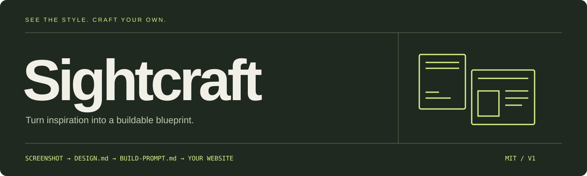
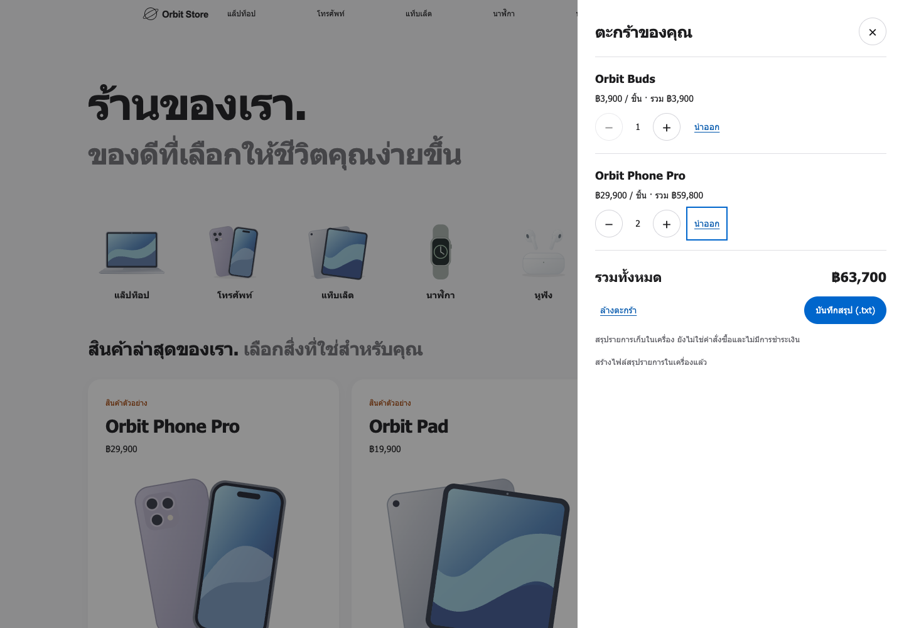
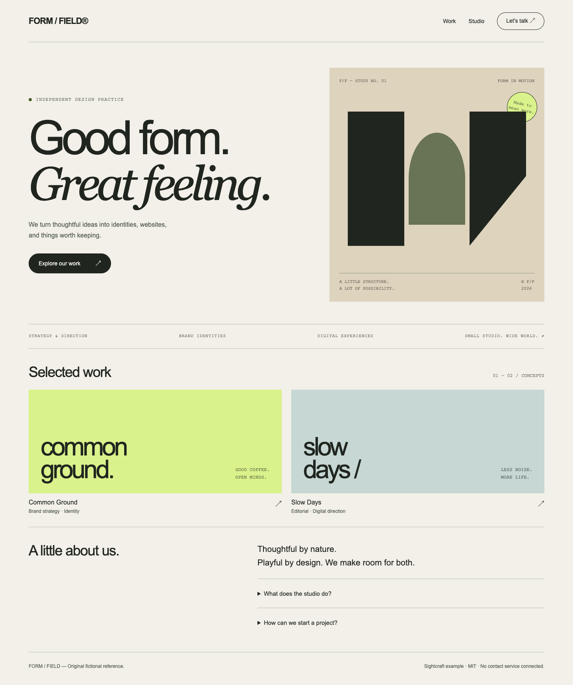
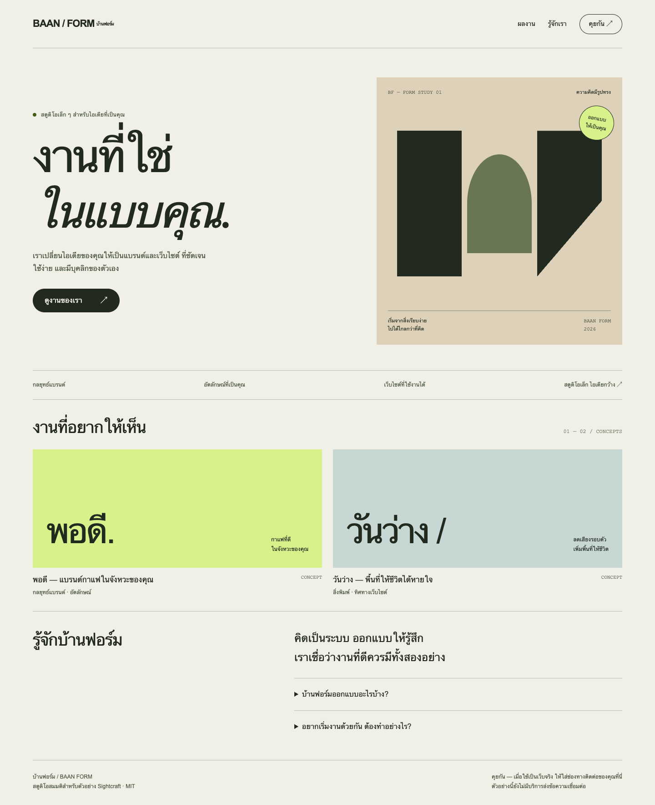

<div align="center">



# เห็นเว็บที่ชอบ สร้างเว็บในแบบของคุณ

**ภาพอ้างอิง → บรีฟดีไซน์ → พรอมป์ต์ → เว็บที่เปิดเทียบได้จริง**

แจกฟรี **Skill ภาษาไทย · บรีฟดีไซน์และ Motion · ตัวอย่างก่อน–หลัง · เดโมร้านค้าที่กดได้จริง**

[](https://github.com/boombignose/sightcraft/actions/workflows/check.yml)
[](LICENSE)
[](skills/sightcraft/SKILL.md)
[](examples/storefront/README.md)

**[เริ่มใช้](#quick-start) · [ดูตัวอย่าง](#examples) · [ติดตั้ง Skill](#install) · [เดโมร้านค้า](#storefront) · [ผลทดสอบ](docs/STOREFRONT-TEST.md)**

**[ดาวน์โหลดชุดไฟล์ ZIP](https://github.com/boombignose/sightcraft/archive/refs/heads/main.zip)**

</div>

---

> **เห็นเว็บที่ชอบ แต่ไม่รู้จะบอก AI ยังไง?** — แนบภาพ แล้วให้ Sightcraft แปลงสิ่งที่เห็นเป็นบรีฟที่ส่งไปสร้างเว็บต่อได้

Sightcraft ช่วย AI อ่านเลย์เอาต์ สี ตัวอักษร และจังหวะพื้นที่ว่างจากภาพเว็บที่คุณชอบ แล้วเขียนบรีฟให้สร้างเว็บด้วยเนื้อหาของคุณ เหมาะกับคนทำเว็บด้วย AI ที่อยากบอกได้มากกว่า “ขอเว็บสวย ๆ แบบนี้”

## ในชุดนี้มีอะไร

| 🧭 อ่านภาพเป็นบรีฟ | 🛠️ ส่งต่อให้ AI สร้าง | ✨ ออกแบบการเคลื่อนไหว | 🛍️ ลองเว็บที่ใช้งานได้ |
| --- | --- | --- | --- |
| เลย์เอาต์ · สี · ตัวอักษร · responsive | DESIGN.md · BUILD-PROMPT.md | trigger · duration · reduced motion | เลือกสินค้า · ตะกร้า · สรุปรายการ |

ชุดนี้เป็น Skill และคู่มือ ใช้ AI ที่อ่านภาพได้และบัญชีที่คุณมีอยู่ ตัวไฟล์ไม่ต้องใช้ API key หรือติดตั้งแพ็กเกจเพิ่ม ค่าใช้ AI ขึ้นกับบริการที่เลือก เว็บตัวอย่างเปิดออฟไลน์ได้

---

<a id="storefront"></a>

## ใหม่ใน 1.1 — Motion และเว็บที่กดใช้งานได้

Skill สร้าง motion/behavior contract ควบคู่บรีฟ: ระบุ trigger, effect, duration/easing, reduced motion และผลหลังการกด ภาพนิ่งจะติดป้าย animation ว่า “เสนอเพิ่ม” ไม่อ้างว่าเห็นพฤติกรรมจริงจากภาพ

**Orbit Store — [วิธีเปิดเดโม](examples/storefront/README.md) · [ไฟล์เว็บ](examples/storefront/index.html)** — มี entrance/hover/cart animation, เพิ่มสินค้า ปรับจำนวน นำออก ล้างตะกร้า จำตะกร้า และดาวน์โหลดไฟล์สรุปรายการในเครื่องได้จริง



[วิธีเปิดและลองใช้งาน](examples/storefront/README.md) · [Motion/behavior design](examples/storefront/DESIGN.md) · [ผลทดสอบจริง](docs/STOREFRONT-TEST.md)

ตะกร้าเป็นเดโมในเครื่อง ไม่มีระบบส่งออเดอร์หรือรับชำระเงิน เปิดผ่าน localhost เพื่อทดสอบการจำตะกร้าหลัง reload ตามคู่มือ ตัวอย่างเดิมยังเปิดจากไฟล์ได้

---

<a id="examples"></a>

## ตัวอย่างก่อน–หลัง

| ภาพอ้างอิงที่สร้างเอง | เว็บที่ปรับเป็นเนื้อหาของเรา |
| --- | --- |
|  |  |

ดาวน์โหลด ZIP แล้วแตกไฟล์ เปิด **index.html** เพื่อดูภาพเทียบ อ่านบรีฟ และเปิดเว็บตัวอย่างได้โดยตรง ลิงก์ไฟล์ HTML บน GitHub จะเปิดซอร์สโค้ด; ให้เปิดไฟล์จากโฟลเดอร์ที่ดาวน์โหลดเพื่อทดลองเว็บ

ตัวอย่างใช้สตูดิโอและผลงานสมมติ ผู้จัดทำออกแบบทั้งต้นแบบและผลลัพธ์เพื่อสาธิตการส่งต่องาน ไม่ใช่ benchmark อิสระ ไม่ได้พิสูจน์ความแม่นยำของโมเดล และไม่ได้รับรองการเหมือนทุกพิกเซล

---

<a id="quick-start"></a>

## เริ่มใช้ใน 3 ขั้น

### 1 · แนบภาพและคำสั่งให้ AI

เปิดแชต AI ที่รองรับภาพ แนบภาพหน้าจอเว็บที่ชอบ และไฟล์สามชิ้นนี้:

1. [SKILL.md](skills/sightcraft/SKILL.md)
2. [DESIGN-TEMPLATE.md](skills/sightcraft/references/DESIGN-TEMPLATE.md)
3. [BUILD-PROMPT-TEMPLATE.md](skills/sightcraft/references/BUILD-PROMPT-TEMPLATE.md)

ถ้าแชตอ่านไฟล์แนบไม่ได้ ให้คัดลอกเนื้อหาสามไฟล์แทน การแนบคำสั่งเป็นการใช้งานด้วยตนเอง ไม่ใช่การติดตั้ง Skill native ให้ทุกบริการ

### 2 · บอกว่าจะทำเว็บของคุณแบบไหน

ส่งคำสั่งนี้ พร้อมเปลี่ยนชื่อและรายละเอียดเป็นของคุณ:

```text
ใช้คำสั่ง Sightcraft และเทมเพลตที่แนบ วิเคราะห์ภาพนี้
ฉันจะทำเว็บสตูดิโอออกแบบชื่อ “บ้านฟอร์ม” ภาษาไทย
อยากรักษาโทนกระดาษ หัวเรื่องใหญ่ และ hero สองคอลัมน์
ใช้เนื้อหาของฉัน ถ้าขาดข้อมูลที่สำคัญให้ถามก่อน
ส่ง DESIGN.md และ BUILD-PROMPT.md
แยกสิ่งที่เห็นจริง ค่าประมาณ ข้อเสนอเพิ่ม และสิ่งที่ยังไม่ทราบ
```

### 3 · รับบรีฟ แล้วสั่งสร้างเว็บ

รับเอกสารสองชิ้น อ่านส่วน “ยังไม่ทราบ” ก่อนส่งเอกสารและภาพไปสั่งสร้างเว็บ ผลงานจริงขึ้นกับ AI และรายละเอียดที่คุณให้ หาก AI เปิดภาพไม่ได้ต้องขอให้ระบุข้อจำกัดก่อน

---

<a id="install"></a>

## ติดตั้ง Skill ใน Codex

คัดลอกโฟลเดอร์ `skills/sightcraft` **ทั้งโฟลเดอร์** จากชุดนี้ ไปยัง `.agents/skills/sightcraft` ในโปรเจกต์ปลายทาง โครงสร้างต้องเป็น:

```text
your-project/
└── .agents/skills/sightcraft/
    ├── SKILL.md
    ├── agents/openai.yaml
    └── references/
        ├── DESIGN-TEMPLATE.md
        └── BUILD-PROMPT-TEMPLATE.md
```

ถ้ามี Skill ชื่อเดียวกันอยู่แล้ว ให้เปรียบเทียบก่อนแทนที่ เปิด Codex ในโปรเจกต์นั้น แนบภาพแล้วพิมพ์:

```text
ใช้ $sightcraft วิเคราะห์ภาพที่แนบ
ทำ DESIGN.md และ BUILD-PROMPT.md สำหรับเว็บของฉัน
```

Codex ตรวจการเปลี่ยนแปลงของ Skill อัตโนมัติ ถ้ายังไม่แสดงให้เปิด Codex ใหม่ รายละเอียดตำแหน่ง Skill ดู [เอกสาร OpenAI](https://learn.chatgpt.com/docs/build-skills) คู่มือนี้ตรวจจากเอกสารวันที่ 14 ตุลาคม 2026; ยังไม่ได้ทดสอบการ discover บนเครื่องใหม่หรือกับทุกเวอร์ชัน

## ผลลัพธ์ที่ได้

| ไฟล์ | ใช้ทำอะไร |
| --- | --- |
| `DESIGN.md` | โครงหน้า tokens เนื้อหา responsive และเกณฑ์ตรวจ พร้อมที่มาของแต่ละข้อ |
| `BUILD-PROMPT.md` | คัดลอกไปสั่ง AI สร้างเว็บ โดยคง stack เดิมและป้ายความไม่แน่นอน |

Skill จบที่เอกสารสองชิ้น สั่งให้สร้างเว็บต่อได้เมื่อพร้อม ตรวจเว็บจริงด้วยภาพขนาดใกล้ต้นแบบและหน้าจอมือถือก่อนใช้งาน

## ลองทำตามตัวอย่าง

1. ใช้ [ภาพอ้างอิง](examples/studio/images/reference-desktop.png) และ [โจทย์บ้านฟอร์ม](examples/studio/BRIEF.md) เป็นอินพุตให้ AI
2. เทียบเอกสารที่ได้กับ [DESIGN.md](examples/studio/DESIGN.md) และ [BUILD-PROMPT.md](examples/studio/BUILD-PROMPT.md) ในชุดนี้ ไม่จำเป็นต้องได้ถ้อยคำเหมือนกัน
3. สั่งสร้างและเปิดเว็บที่ได้ เทียบกับ [เว็บผลลัพธ์ตัวอย่าง](examples/studio/result/index.html)
4. ลองใช้ [ภาพที่ถูกตัด](examples/studio/images/reference-cropped.png) แล้วดูว่า AI ระบุส่วนที่ไม่เห็นตาม [CROPPED-CASE.md](examples/studio/CROPPED-CASE.md) หรือไม่

ภาพเดียวไม่บอกชื่อฟอนต์จริง ค่า CSS ทั้งหมด hover หรือโครงมือถือ การเขียน hex/px ไม่ทำให้ค่าประมาณกลายเป็นผลวัด ถ้าข้อความในภาพเบลอหรือตัดไป ต้องระบุสิ่งที่ยังไม่ทราบ

## ตรวจชุดไฟล์

ผู้ใช้ทั่วไปเปิดตัวอย่างได้โดยไม่ต้องใช้ Python สำหรับผู้พัฒนา ใช้ Python 3.9+ standard library:

```sh
python3 -m unittest discover -s tests -v
python3 scripts/check_repo.py
node --test tests/cart.test.cjs
```

Python ใช้ standard library ส่วนตะกร้าใช้ Node 22 built-ins เฉพาะการพัฒนาทดสอบ ตัวอย่างที่เปิดใน browser ไม่ต้องติดตั้ง Node ตัวตรวจเช็กไฟล์จำเป็น ลิงก์ inline Markdown/HTML และ anchor ของ HTML โดยไม่เรียกเน็ต ไม่ตรวจ Markdown anchor, CSS URL, reference-style Markdown หรือคุณภาพงาน AI รายงานภาพเดิมอยู่ใน [TEST-REPORT.md](docs/TEST-REPORT.md) และผลใหม่อยู่ใน [STOREFRONT-TEST.md](docs/STOREFRONT-TEST.md) ตรวจสถานะรันล่าสุดได้ที่ [GitHub Actions](https://github.com/boombignose/sightcraft/actions/workflows/check.yml)

## ใช้ต่อและแจกต่อ

โค้ด เอกสาร ภาพตัวอย่าง และกราฟิกในชุดนี้สร้างขึ้นสำหรับ Sightcraft ใช้ได้ แก้ได้ Fork ได้ และแจกต่อได้ตาม [MIT License](LICENSE) เก็บข้อความลิขสิทธิ์และใบอนุญาตไว้เมื่อแจกต่อ เมื่อใช้ภาพและเนื้อหาของคุณเองให้ตรวจสิทธิ์ของ assets ชุดนั้นตามจริง

Sightcraft ไม่เชื่อมเว็บไซต์หรือบัญชี ไม่ดึง URL อัตโนมัติ และไม่เผยแพร่งานให้ บันทึกภาพเว็บที่คุณต้องการใช้เองแล้วแนบเข้า AI ตามขั้นตอนข้างต้น
